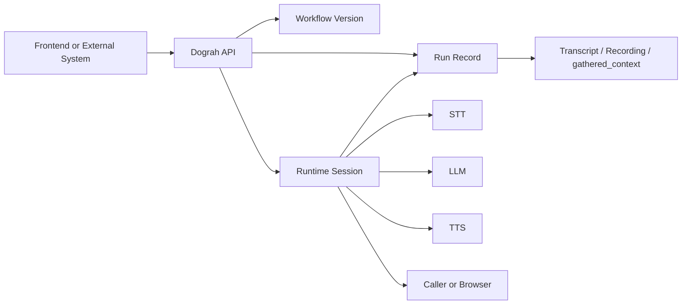
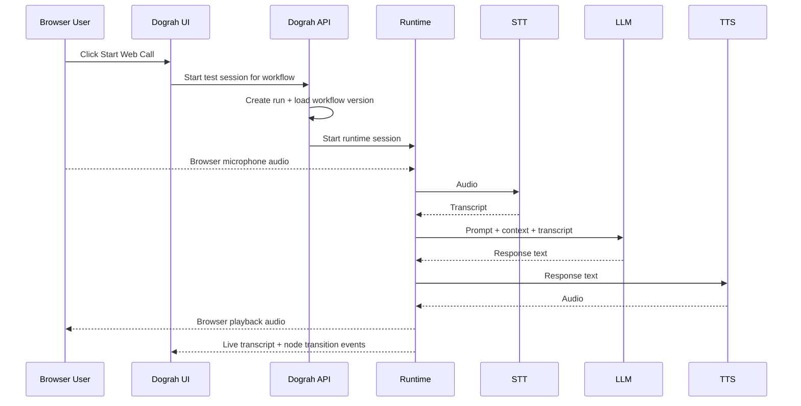
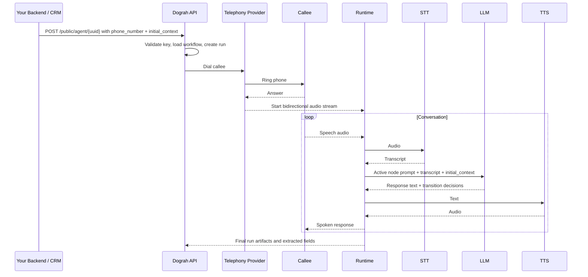
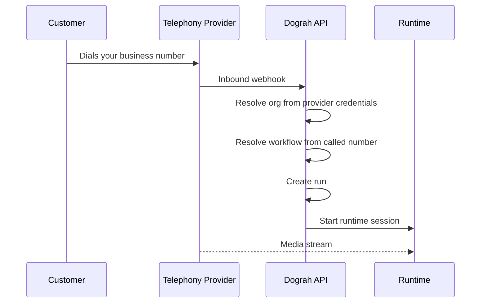
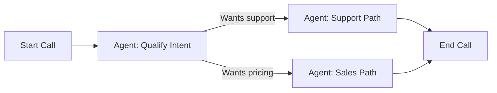
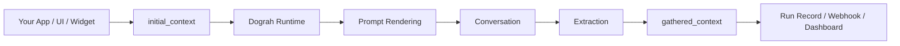

This page explains the part that often confuses new engineers:

If the UI is where the agent is designed, and the API stores it, then **who is actually having the conversation**?

The answer is: the conversation is a coordinated effort between:

- the **frontend**
- the **backend**
- the **real-time runtime**
- external systems such as **telephony providers**, **STT providers**, **LLM providers**, and **TTS providers**

The important idea is that Dograh works like an orchestrated pipeline, not like a single monolith function call.

## Start with the split of responsibilities

### Frontend

The frontend is responsible for:

- letting users create and edit workflow graphs
- saving drafts and publishing agents
- starting test sessions such as Web Calls
- rendering live transcript, node transitions, and run history
- embedding widgets into external websites

The frontend is usually the **initiator and observer**, not the main executor of the AI conversation.

### Backend

The backend is responsible for:

- authenticating requests
- storing workflows and versions
- creating and updating run records
- deciding which workflow version should execute
- initiating outbound calls
- handling inbound webhooks from telephony providers
- coordinating storage, queueing, and post-call actions

The backend is the **orchestrator and source of truth**.

### Runtime

The runtime is responsible for:

- consuming the active workflow definition
- maintaining conversation state
- sending user audio to STT
- sending prompt + context + transcript to the LLM
- sending reply text to TTS
- emitting audio back to the caller or browser
- evaluating transitions between nodes
- extracting structured variables

The runtime is the **live conversation engine**.

## The core handshake



Read it like this:

1. Something starts the session.
2. The API selects the workflow/version and creates a run.
3. The runtime runs the actual conversation.
4. The run record is updated with outputs.

## Example 1: Browser Web Call

This is the easiest path to understand because no telephony provider is involved.

### Product story

A user builds an agent in the UI and clicks **Start Web Call**.

### What the frontend does

- sends a request to start a session for a specific workflow
- opens the browser media/WebRTC path
- shows live transcript and node changes

### What the backend does

- validates the request
- creates a run
- loads the latest workflow definition
- starts a runtime session

### What the runtime does

- accepts browser audio
- transcribes it
- runs the active node prompt through the LLM
- synthesizes the reply
- streams audio back to the browser

### Web Call sequence



### Why this is useful

A Web Call proves the workflow logic without requiring:

- a phone number
- provider credentials
- inbound webhook setup

That makes it the fastest feedback loop for prompt and graph debugging.

## Example 2: Outbound phone call triggered by your backend

This is where frontend and backend work together indirectly.

The frontend defines the agent, but your own backend system may be the thing that actually triggers the call.

### Typical business example

Your CRM receives a new lead and wants Dograh to call them immediately.

### What the frontend already did before this happens

- a product user created the workflow in the Dograh dashboard
- added an **API Trigger** node
- published the workflow
- configured telephony

### What your backend sends

Your backend calls the Dograh trigger endpoint with `phone_number` and `initial_context`.

Example:

```bash
curl -X POST https://your-dograh-instance/api/v1/public/agent/test/{uuid} \
  -H "Content-Type: application/json" \
  -H "X-API-Key: dg_your_api_key" \
  -d '{
    "phone_number": "+14155550100",
    "initial_context": {
      "customer_name": "Jane",
      "company_name": "Acme Inc",
      "lead_source": "Website Demo Form"
    }
  }'
```

### What the backend does

- authenticates the API key
- resolves the agent from the trigger UUID
- chooses the workflow version to run
- creates a run
- uses the configured telephony provider to dial the target number

### What the runtime does after the callee answers

- receives the media stream
- transcribes the callee's speech
- sends prompt + context to the LLM
- generates the reply
- streams synthesized audio back

### Full outbound sequence



## Example 3: Inbound phone call

Inbound is the reverse of outbound.

Instead of Dograh deciding who to call, the customer calls your number first.

### What must exist first

- telephony configuration
- one or more phone numbers
- an inbound workflow assigned to that number

### Inbound sequence



The key backend job here is **routing**:

- identify which organization owns the telephony credentials
- identify which workflow is assigned to the called number

## Example 4: Website embed widget

Dograh also supports adding the agent directly to a website.

This can be:

- **Voice widget**: microphone + live voice interaction
- **Chat widget**: text-based interaction

### What the frontend on your website does

It loads the generated widget script and optionally passes visitor context.

Conceptually:

```html
<script>
  (function(d, s, id) {
    var js, fjs = d.getElementsByTagName(s)[0];
    if (d.getElementById(id)) return;
    js = d.createElement(s);
    js.id = id;
    js.src = '<dashboard-generated widget URL>';
    js.setAttribute('data-dograh-context', JSON.stringify({
      page_url: window.location.href,
      customer_name: 'Jane'
    }));
    js.async = true;
    fjs.parentNode.insertBefore(js, fjs);
  }(document, 'script', 'dograh-widget'));
</script>
```

### What this means in practice

- your website is the host frontend
- Dograh provides the conversation widget/runtime bridge
- the website can pass `initial_context`-like data for the next conversation

### Website voice flow

```mermaid
sequenceDiagram
    participant Site as Your Website
    participant Widget as Dograh Widget
    participant API as Dograh API
    participant RT as Runtime
    participant Visitor as Website Visitor

    Site->>Widget: Load embed script + context
    Visitor->>Widget: Click Talk
    Widget->>API: Start website voice session
    API->>RT: Create run + start runtime
    Visitor<->>RT: Audio conversation
    RT-->>Widget: Status + transcript events
    Widget-->>Site: Callback hooks if registered
```

## How the graph affects runtime behavior

A common junior-level confusion is:

"If the LLM is generating the text, what is the graph doing?"

The graph constrains and structures the conversation.

The LLM is not speaking into an empty void. It is speaking from the currently active node.

### Active node rule

At any moment:

- one node is active
- its prompt is the current instruction set
- outgoing edges describe the allowed next transitions

Example:



The runtime keeps checking:

- what has the user said so far?
- does one edge condition now match?
- if yes, move to the next node

So:

- the **LLM generates local behavior**
- the **graph controls global structure**

## How data moves through the system

The cleanest way to understand this is as an input/output pipeline.



### `initial_context`

Input data known before the conversation starts.

Examples:

- customer name
- plan
- debt amount
- appointment date

Used in prompts through template variables such as `{{customer_name}}`.

### `gathered_context`

Output data learned during the conversation.

Examples:

- confirmed = true
- payment_method = "card"
- callback_requested = false

This is not usually fed back into agent prompts during the same flow. It is primarily used:

- in webhook payloads
- in the run record
- in your downstream systems

## How frontend and backend go hand in hand

Here is the best way to explain it to a junior engineer:

### Frontend without backend is incomplete

The frontend can draw nodes and edges, but it cannot:

- persist the real source of truth
- place phone calls
- verify webhooks
- store run history

### Backend without frontend is also incomplete

The backend can execute workflows, but without the frontend you lose:

- the visual editor
- easy testing
- dashboard observability
- website embed configuration UI

So the real product is the combination:

- **frontend creates the intent**
- **backend operationalizes it**
- **runtime enacts it**

## A full hand-in-hand example

Imagine a support team wants a website voice assistant and a fallback outbound callback flow.

### Frontend side

- Product manager creates the workflow in the dashboard
- adds prompts, pathways, and a webhook node
- configures the website widget

### Website frontend side

- website loads the widget
- passes `customer_id` or `plan`
- visitor starts a conversation

### Backend side

- backend stores the published workflow
- runtime executes it
- webhook sends final structured results back to support systems

### Follow-up backend automation

If the call ends with "needs human callback", your own backend can later trigger an outbound Dograh call using the API Trigger endpoint and pass the earlier customer context back in.

That is a good example of frontend and backend working together across multiple steps rather than one screen.

## Debugging mindset for juniors

When something breaks, first decide **which layer owns the problem**.

### Frontend-shaped problems

- button not starting the widget
- graph UI not saving changes
- transcript/status not rendering

### Backend-shaped problems

- `401` or `403` auth failures
- trigger endpoint not found
- telephony config missing
- webhook validation failures

### Runtime-shaped problems

- speech not transcribing
- wrong edge transitions
- LLM answers make sense locally but route badly globally
- TTS response not playing back

This separation saves a lot of time in real debugging.

## What to remember

- the frontend is where humans configure and observe
- the backend is the orchestrator and data owner
- the runtime executes the live call or session
- telephony/WebRTC are transport layers, not the conversation brain
- `initial_context` goes in, `gathered_context` comes out
- runs are the audit trail of the whole interaction

## Related reading

- [Project Overview for Juniors](/getting-started/project-overview-for-juniors)
- [How Dograh Works](/core-concepts/how-dograh-works)
- [Workflows & Agents](/core-concepts/workflows-and-agents)
- [Calls & Runs](/core-concepts/calls-and-runs)
- [Context & Variables](/core-concepts/context-and-variables)
