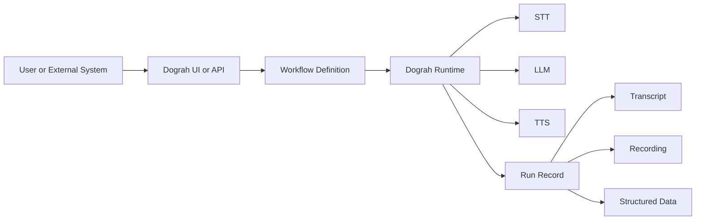
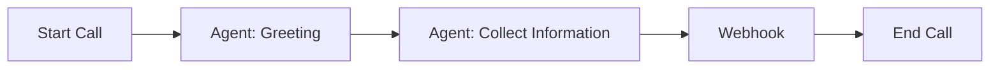
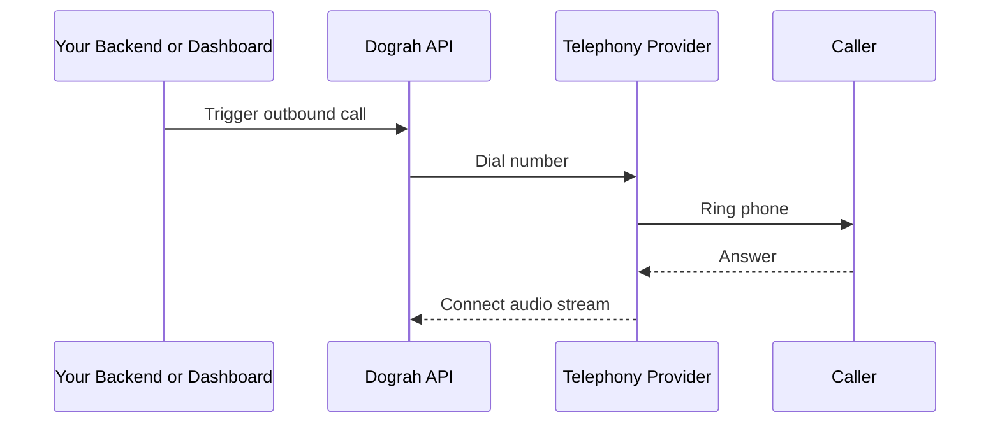

If you're new to the codebase, the easiest way to think about Dograh is:

- The **UI** is where you build and test an agent.
- The **API** is where the agent definition, runs, telephony, and storage logic live.
- The **voice pipeline** is what turns speech into text, sends it to an LLM, and turns the reply back into audio.
- Supporting services like **Postgres**, **Redis**, and **MinIO** make the platform stateful and production-ready.

Dograh is not "just a chatbot" and not "just a phone system". It is the system in the middle that coordinates both.

## The mental model

When someone uses Dograh, one of two things usually happens:

1. A user builds an agent in the dashboard and tests it in the browser with a **Web Call**.
2. A backend system or telephony provider triggers a real phone call, and Dograh runs the same agent over live audio.

In both cases, the same core engine runs the conversation.



## Repository layout

### `ui/`

This is the **Next.js frontend**. It is the product surface users interact with.

Typical responsibilities:

- create and edit workflows in the visual builder
- configure telephony and API keys
- test with Web Calls
- inspect past runs, transcripts, and recordings
- configure "Add to Website" widgets

Think of `ui/` as the **control room**.

Example:

- A user clicks **Create Agent**
- fills in a use case
- edits prompts and edges in the visual graph
- starts a Web Call from the browser

The UI itself does not decide what the AI says. It sends configuration and user actions to the backend, then renders the result.

### `api/`

This is the **FastAPI backend**. It is the main application server.

Typical responsibilities:

- store workflows and versions
- expose REST endpoints
- create and track runs
- start outbound calls
- accept inbound telephony webhooks
- manage recordings, transcripts, and extracted data
- coordinate with background services and the runtime pipeline

Think of `api/` as the **orchestrator**.

Example:

- Your backend sends `POST /api/v1/public/agent/{uuid}`
- Dograh validates the request
- creates a run
- uses the configured telephony provider to place the call
- stores the final transcript and output after the call ends

### `pipecat/`

This is the **real-time voice pipeline submodule**.

Its job is not product UI or business CRUD. Its job is the media loop:

- receive audio
- transcribe speech to text
- send text and prompt context to the LLM
- convert the LLM response back to speech
- stream the audio back live

Think of `pipecat/` as the **conversation engine**.

### `docs/`

This is the **Mintlify documentation site** written in MDX.

It is separate from the product runtime, but very important because it explains:

- how to deploy Dograh
- how to create workflows
- how to trigger calls
- how telephony and webhooks work

### `scripts/`

This folder holds **developer and deployment helper scripts**.

Examples:

- start backend services locally
- stop them cleanly
- bootstrap deployment configs
- help with updates and setup flows

### `deploy/`

This contains deployment templates such as **nginx** and **coturn** configuration used in remote setups.

This matters for:

- HTTPS termination
- proxying traffic to the API and UI
- TURN support for WebRTC in remote environments

## Runtime dependencies

Dograh depends on several supporting services. These are visible in the Docker Compose files.

### Postgres

Use Postgres for durable relational data:

- workflows
- versions
- runs
- telephony configurations
- metadata

If the UI is the control room and the API is the orchestrator, Postgres is the **memory**.

### Redis

Use Redis for fast coordination and background work:

- queues
- transient state
- background task communication

Think of Redis as the **short-term scratchpad and queue lane**.

### MinIO

Use MinIO as S3-compatible object storage for:

- call recordings
- generated audio assets
- downloadable artifacts

Think of MinIO as the **file cabinet for binary assets**.

## What an "agent" really is

In the UI, users say **agent**.

In the API and schema docs, the underlying object is a **workflow**.

Those are two names for the same concept:

- **Agent** = product term
- **Workflow** = technical definition

The workflow is a graph of:

- **nodes**: steps such as `startCall`, `agentNode`, `webhook`, `endCall`
- **edges**: the conditions that decide where the conversation goes next



## The main data objects

### `workflow_definition`

This is the full graph configuration used by both the dashboard and the API.

The UI writes it visually.
The backend stores it.
The runtime executes it.

### `initial_context`

This is data supplied **before** the call starts.

Examples:

- customer name
- account ID
- appointment date
- CRM record values

Why it matters:

The agent can use this data inside prompts, so it sounds prepared from the first sentence.

Example:

```json
{
  "phone_number": "+14155550100",
  "initial_context": {
    "customer_name": "Jane",
    "appointment_date": "March 15"
  }
}
```

Prompt example:

```text
You are calling {{customer_name}} about their appointment on {{appointment_date}}.
```

### `gathered_context`

This is structured data extracted **during or after** the call.

Examples:

- whether the customer confirmed
- preferred callback time
- payment amount promised
- sentiment

Why it matters:

This is how a conversation becomes something your backend can act on.

### Run

Every execution creates a **run**.

A run contains:

- status
- transcript
- recording
- initial context
- gathered context
- usage and cost

## How frontend and backend divide the work

Here is the simplest division of responsibility:

| Layer | Main job |
|---|---|
| `ui/` | define and observe |
| `api/` | validate, persist, orchestrate |
| `pipecat/` | run the real-time conversation loop |
| Postgres / Redis / MinIO | store, queue, and serve data |

### Frontend example

User action:

1. Open the workflow builder
2. Add an **API Trigger** node
3. Add a **Webhook** node
4. Save and publish

Frontend responsibility:

- send the updated workflow definition to the backend
- render status, graph state, and testing tools

### Backend example

Backend/API responsibility after publish:

- save the current workflow definition version
- expose the trigger endpoint
- use the published version for production traffic

## Two ways conversations start

### 1. Web Call from the browser

Good for:

- testing quickly
- no telephony setup
- debugging prompts and flow changes

Flow:

```mermaid
sequenceDiagram
    participant U as Browser User
    participant UI as Dograh UI
    participant API as Dograh API
    participant RT as Runtime

    U->>UI: Click Start Web Call
    UI->>API: Request web session
    API->>RT: Start workflow run
    RT-->>UI: Live transcript + events
    U<->>RT: Browser audio conversation
```

### 2. Phone call through telephony

Good for:

- real customers
- outbound campaigns
- inbound support numbers

Flow:



## A complete beginner example

Imagine you are building an appointment reminder agent.

### What the frontend does

- A product user creates the workflow in the builder
- adds a start node, one agent node, and one end node
- tests it with a Web Call

### What the backend does

- stores that workflow definition
- exposes a trigger URL
- creates runs whenever the agent is used

### What your external system does

Your clinic backend sends:

```json
{
  "phone_number": "+14155550100",
  "initial_context": {
    "customer_name": "Jane",
    "appointment_date": "2026-08-22",
    "doctor_name": "Dr. Sharma"
  }
}
```

### What the runtime does

- reads the prompt
- substitutes variables
- talks to the customer
- extracts something like:

```json
{
  "confirmed": true,
  "preferred_time": "10:30 AM"
}
```

### What Dograh returns

At the end of the call, the run and optional webhook let your backend know the result.

## How to read the codebase without getting lost

If you are a junior engineer, use this order:

1. Read [How Dograh Works](/core-concepts/how-dograh-works)
2. Read [Workflows & Agents](/core-concepts/workflows-and-agents)
3. Read [Calls & Runs](/core-concepts/calls-and-runs)
4. Read [Context & Variables](/core-concepts/context-and-variables)
5. Read [Frontend, Backend, and Runtime Handshake](/core-concepts/frontend-backend-and-runtime)

That order helps because it goes from product view to runtime detail.

## What to remember

- Dograh is a **workflow-driven voice AI platform**
- the **UI** defines and tests the agent
- the **API** persists and orchestrates it
- the **runtime pipeline** handles the live conversation
- **runs** are the source of truth for what happened
- `initial_context` goes **into** the call
- `gathered_context` comes **out of** the call

## Next steps

If you want to understand the runtime in more detail, continue with [Frontend, Backend, and Runtime Handshake](/core-concepts/frontend-backend-and-runtime).
