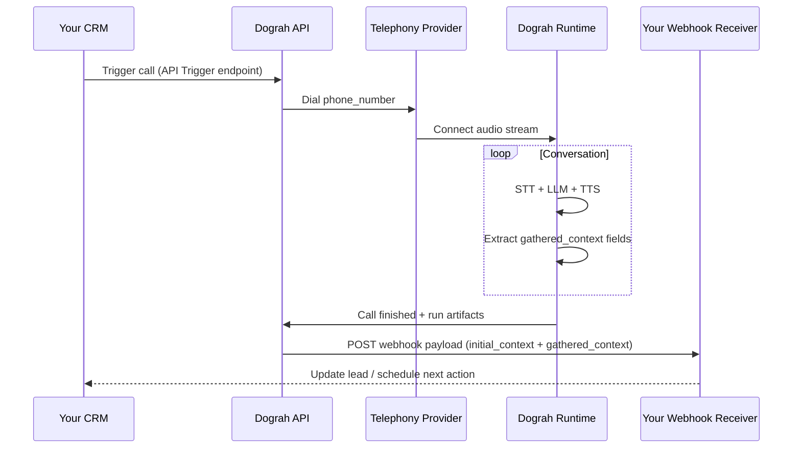

This walkthrough is meant for juniors.

We’ll follow one real “customer journey” from the moment your business receives a lead until your system gets structured results back after the call.

## Scenario

Your CRM has a new lead row:

- `customer_name`
- `phone_number`
- `account_id`
- maybe extra columns like `plan`, `requested_time`, etc.

You want:

1. Dograh to **call** the lead immediately (outbound).
2. Dograh to run your agent, ask the right questions, and extract structured answers.
3. When the call ends, Dograh to **POST a webhook** back to your system with:
   - the values you passed in (`initial_context`)
   - the values the agent extracted (`gathered_context`)

## What you build in the Dograh UI

In the dashboard, you create/publish a workflow (agent).

Minimum nodes for this journey:

- `startCall` / greeting
- one or more `agentNode` steps that ask questions
- optional variable extraction on the final steps
- a `webhook` node to send results to your backend

If you want the call to start from your backend, include an **API Trigger** node.

Relevant reading:

- API Trigger: /voice-agent/api-trigger
- Webhook node: /voice-agent/webhook
- Context model: /core-concepts/context-and-variables

## What your backend does

Your backend (CRM integration) does two jobs:

1. Trigger the call using the API Trigger endpoint
2. Receive the webhook payload after the call ends

### Step A: Trigger an outbound call (backend → Dograh)

Your system calls Dograh’s API Trigger production (or test) endpoint.

Dograh’s docs show this shape:

```bash
curl -X POST https://your-dograh-instance/api/v1/public/agent/test/{uuid} \
  -H "Content-Type: application/json" \
  -H "X-API-Key: dg_your_api_key" \
  -d '{
    "phone_number": "+14155550100",
    "initial_context": {
      "customer_name": "Jane",
      "account_id": "ACC-123",
      "plan": "premium"
    }
  }'
```

Key junior takeaway:

`initial_context` is where your CRM data goes into the agent so it can respond naturally from the first sentence.

### Step B: Receive the webhook after the call ends (Dograh → backend)

During the call, the agent may extract structured values (for example: confirmation status, preferred time, disposition).

At the end, your Dograh workflow’s **Webhook node** sends a request to your backend.

Your webhook payload template typically references:

- `{{initial_context.<field>}}`
- `{{gathered_context.<field>}}`

Example idea (your exact fields depend on your agent extraction config):

```json
{
  "customer_name": "{{initial_context.customer_name}}",
  "account_id": "{{initial_context.account_id}}",
  "plan": "{{initial_context.plan}}",
  "confirmed": "{{gathered_context.confirmed}}",
  "preferred_time": "{{gathered_context.preferred_time}}",
  "call_disposition": "{{gathered_context.call_disposition}}"
}
```

Key junior takeaway:

Your backend now has a structured record you can write back into your CRM (no manual transcription reading required).

## Full end-to-end diagram



## Optional extension: follow-up outbound call

Once your backend receives the webhook, you can decide what to do next.

Example:

- if `confirmed` is false, schedule an appointment for another time
- if the agent requests human callback, your backend can trigger another Dograh outbound call later

That follow-up is still the same pattern:

- your system triggers a new run with API Trigger
- you pass `initial_context` again
- Dograh runs the workflow and sends back results via webhook

## How to test this journey quickly

1. Start with a **Web Call** to validate prompts and edges.
2. Add extraction on the nodes where you want structured answers.
3. Add a webhook node that posts to your test endpoint.
4. Only after that, connect telephony and switch to API Trigger for real calls.

Relevant reading:

- How Dograh Works: /core-concepts/how-dograh-works
- Calls & Runs: /core-concepts/calls-and-runs
- Context & Variables: /core-concepts/context-and-variables

